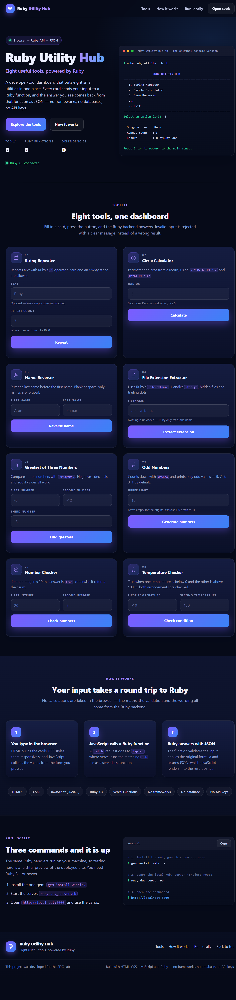

# Ruby Utility Hub

**Eight useful tools, powered by Ruby** — a developer-tool dashboard with a static
HTML/CSS/JavaScript front end and a **Ruby** backend that runs as serverless
functions on Vercel.

Type a value into a card, press the button, and the answer comes back from a Ruby
function as JSON. No frameworks, no database, no API keys, no secrets.

### Preview



| # | Tool | Ruby method | Endpoint |
|---|------|-------------|----------|
| 01 | String Repeater | `Hub.string_repeater` | `/api/string_repeater` |
| 02 | Circle Calculator | `Hub.circle_calculator` | `/api/circle_calculator` |
| 03 | Name Reverser | `Hub.name_reverser` | `/api/name_reverser` |
| 04 | File Extension Extractor | `Hub.file_extension` | `/api/file_extension` |
| 05 | Greatest of Three Numbers | `Hub.greatest_of_three` | `/api/greatest_of_three` |
| 06 | Odd Numbers (10 → 1) | `Hub.odd_numbers` | `/api/odd_numbers` |
| 07 | Number Checker | `Hub.number_checker` | `/api/number_checker` |
| 08 | Temperature Checker | `Hub.temperature_checker` | `/api/temperature_checker` |

The formulas and validation rules are the same ones used by the original terminal
program, [`ruby_utility_hub.rb`](./ruby_utility_hub.rb), which is kept in this repo
unchanged and still runs with `ruby ruby_utility_hub.rb`.

---

## 1. Project structure

```
ruby-utility-hub/
├── index.html            # the dashboard (navbar, hero, 8 tool cards, footer)
├── style.css             # dark navy / white / purple responsive theme
├── script.js             # collects form values, calls the API, renders JSON
├── api/                  # ← Vercel turns each of these into a function
│   ├── string_repeater.rb
│   ├── circle_calculator.rb
│   ├── name_reverser.rb
│   ├── file_extension.rb
│   ├── greatest_of_three.rb
│   ├── odd_numbers.rb
│   ├── number_checker.rb
│   └── temperature_checker.rb
├── lib/
│   └── hub.rb            # ALL shared logic: validation + the 8 calculations
├── dev_server.rb         # local server that mimics Vercel's Ruby runtime
├── test/
│   ├── hub_test.rb       # 59 assertions on the Ruby logic
│   ├── http_test.rb      # 43 end-to-end HTTP tests (needs the server running)
│   └── vercel_sim.rb     # 42 assertions that mimic Vercel's Ruby bootstrap
├── ruby_utility_hub.rb   # the original console program (unchanged)
├── screenshot.png        # preview image shown at the top of this README
├── Gemfile               # declares the single gem: webrick
├── .gitignore
└── README.md
```

**No `vercel.json` is needed.** Vercel serves the files in the project root as the
static site and automatically turns every `api/*.rb` into a serverless function.

---

## 2. Run it locally

You need Ruby 3.1 or newer (`ruby -v` to check).

```bash
# 1. go to the project folder
cd ruby-utility-hub

# 2. install the one gem (WEBrick powers the local server)
gem install webrick

# 3. start the server
ruby dev_server.rb
```

Then open **https://ruby-utility-hub.vercel.app/**. Stop the server with `Ctrl + C`.

> Using Bundler instead? `bundle install` then `ruby dev_server.rb` also works —
> `Gemfile.lock` is git-ignored on purpose so the lockfile never blocks a deploy.

### How the local server relates to Vercel

Vercel runs your handler like this: `require` the `api/*.rb` file, take its
`Handler` proc, and mount it on a WEBrick server. `dev_server.rb` does **exactly
the same thing** on your machine, so what you test locally is what Vercel runs.

---

## 3. Test each of the eight tools

Open https://ruby-utility-hub.vercel.app/ and use the cards, or check the JSON directly.

| Tool | What to type | Expected result |
|------|--------------|-----------------|
| 1 · String Repeater | Text `Ruby`, count `3` | Result `RubyRubyRuby` |
| 1 · String Repeater | Text *(empty)*, count `0` | Result `(empty string)` |
| 1 · String Repeater | count `-2`, then `abc`, then `3` | Two error messages, then the result |
| 2 · Circle Calculator | radius `5` | Perimeter `31.42`, Area `78.54` |
| 2 · Circle Calculator | radius `0` | Perimeter `0.00`, Area `0.00` |
| 2 · Circle Calculator | radius `-3` or `x` | `Radius must be 0 or more.` / `…must be a number…` |
| 3 · Name Reverser | `Arun`, `Kumar` | Reversed name `Kumar Arun` |
| 3 · Name Reverser | first name `   ` (spaces) | `First name cannot be empty or only spaces.` |
| 4 · File Extension | `archive.tar.gz` | Extension `gz` |
| 4 · File Extension | `notes` | `No extension found.` + reason |
| 4 · File Extension | `.bashrc` | `No extension found.` + hidden-file reason |
| 4 · File Extension | `report.` | `No extension found.` + trailing-dot reason |
| 5 · Greatest of Three | `-5`, `-12`, `-3` | Greatest `-3` |
| 5 · Greatest of Three | `7`, `7`, `7` | Greatest `7` |
| 5 · Greatest of Three | `3.5`, `-1.25`, `2` | Greatest `3.5` |
| 6 · Odd Numbers | leave limit empty | Chips `9 7 5 3 1` |
| 6 · Odd Numbers | limit `5` | Chips `5 3 1` |
| 6 · Odd Numbers | limit `0` | `Upper limit must be 1 or more.` |
| 7 · Number Checker | `20`, `5` | Result `true` |
| 7 · Number Checker | `12`, `4` | Sum `16` |
| 7 · Number Checker | `2.5`, `1` | `First integer must be a whole number…` |
| 8 · Temperature | `-10`, `150` | Condition `true` |
| 8 · Temperature | `20`, `50` | Condition `false` |
| 8 · Temperature | `0`, `100` | Condition `false` (strict `<` and `>`) |
| any card | click the button with a blank required field | `… is required.` without a request |

You can also query the API straight from the browser:

```
http://localhost:3000/api/circle_calculator?radius=5
http://localhost:3000/api/odd_numbers?limit=10
http://localhost:3000/api/name_reverser?first=Arun&last=Kumar
```

### Automated tests (optional)

Three scripts in `test/` repeat every check automatically. They use only the Ruby
standard library, so no extra gems are needed:

```bash
# 1. the Ruby logic        -> "59 passed, 0 failed"
ruby test/hub_test.rb

# 2. the HTTP round trip   -> "43 passed, 0 failed"   (start the server first)
ruby test/http_test.rb

# 3. the Vercel contract   -> "42 passed, 0 failed"   (no server needed)
ruby test/vercel_sim.rb
```

---

## 4. API reference

All endpoints accept **GET** with query parameters and answer with JSON.

**Success (HTTP 200)**

```json
{
  "ok": true,
  "tool": "Circle Calculator",
  "summary": "Perimeter 31.42 · Area 78.54",
  "rows": [
    { "label": "Radius", "value": "5" },
    { "label": "Perimeter (circumference)", "value": "31.42" },
    { "label": "Area", "value": "78.54" }
  ]
}
```

`rows` is what the page renders; some tools also return `chips` (a list of
values) — for example the odd numbers.

**Error (HTTP 400)**

```json
{ "ok": false, "error": "Radius must be 0 or more." }
```

| Endpoint | Parameters | Notes |
|----------|-----------|-------|
| `/api/string_repeater` | `text` (≤100 chars, optional), `count` (0–1000) | uses `text * count` |
| `/api/circle_calculator` | `radius` (0–1000000) | `2·π·r` and `π·r²`, two decimals |
| `/api/name_reverser` | `first`, `last` (≤60 chars) | rejects blank/whitespace-only |
| `/api/file_extension` | `filename` (≤255 chars) | `File.extname`, dot removed |
| `/api/greatest_of_three` | `a`, `b`, `c` | integers or decimals |
| `/api/odd_numbers` | `limit` (1–10000, optional → 10) | descending odd numbers |
| `/api/number_checker` | `a`, `b` | whole numbers only |
| `/api/temperature_checker` | `a`, `b` | integers or decimals |

Status codes: `200` success · `400` invalid input · `405` not a GET request ·
`404` unknown tool (local server) · `500` unexpected server error.

**Why the limits?** The console program has none because only you can type into
it. A public endpoint must not accept unlimited work, so the web version caps
length and counts. The formulas themselves are unchanged.

---

## 5. Upload to GitHub

```bash
cd ruby-utility-hub

git init
git add .
git commit -m "Ruby Utility Hub: static dashboard + Ruby API"

# create the repository on https://github.com/new  (name: ruby-utility-hub, keep it Public),
# then connect and push:
git remote add origin https://github.com/<your-username>/ruby-utility-hub.git
git branch -M main
git push -u origin main
```

`.gitignore` already excludes `.vercel/`, `node_modules/`, `Gemfile.lock`,
`.env*` and log files. **This project contains no secrets — never add any.**

---

## 6. Deploy to Vercel

1. Sign in at **https://vercel.com** (a GitHub account works).
2. Click **Add New → Project** and import the `ruby-utility-hub` repository.
3. Vercel detects no framework and uses the **"Other"** preset:
   - **Build Command:** *(leave empty)*
   - **Output Directory:** *(leave empty — the root is served as-is)*
   - **Install Command:** *(leave empty)*
4. Press **Deploy**. Vercel installs the `Gemfile` dependencies, packages each
   `api/*.rb` with the `@vercel/ruby` builder, and serves `index.html`.
5. When it finishes you get a public URL such as
   `https://ruby-utility-hub.vercel.app`.
6. To confirm it really works, open
   `https://<your-url>/api/odd_numbers?limit=10` — you should see JSON with
   `"chips":["9","7","5","3","1"]`, then use the eight cards on the home page.

Redeploy automatically happens on every `git push`.

---

## 7. Honest notes about the Vercel Ruby runtime

- **The Ruby runtime is in Beta** on all Vercel plans (Vercel's own
  documentation). It works, but expect occasional platform changes.
- **Hobby plan limit: 12 functions per deployment.** This project uses **8**, so
  it fits with room to spare.
- **Region:** functions run in a single region by default (`iad1`), so visitors
  far from it may see a slightly slower first response.
- **Cold starts:** each function runs in a microVM; the first request after idle
  can take a moment. The page shows a loading spinner while that happens.
- **Ruby version:** Vercel defaults to Ruby **3.3.x**, which matches the version
  this project was written and tested with. No `ruby "…"` line is set in the
  `Gemfile`, so Vercel keeps using its default.
- **Local testing needs one gem** (`webrick`) because Vercel ships WEBrick
  inside its runtime while your own machine does not. That is the only
  dependency of the whole project.
- **Honesty check:** the backend was tested locally over real HTTP (59 logic
  assertions plus endpoint requests). The Vercel deployment itself has **not**
  been run from this machine, because it requires your Vercel account — follow
  section 6 and verify with the URL above before sharing the link.

---

## 8. License / use

Free to use, read and modify for your own learning and portfolio.
